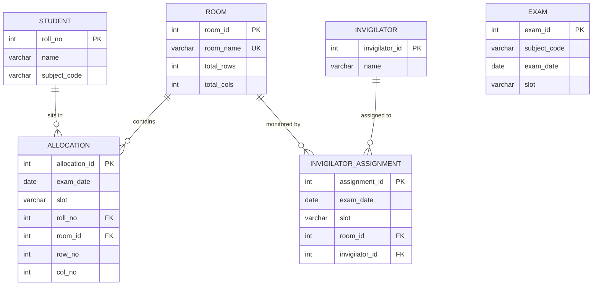

# VYAVASTHA (व्यवस्था)
## Intelligent Examination Seating & Invigilation Management System
> **Academic Project Submission**  
> **Course:** Object-Oriented Programming with Java & Data Structures  
> **Program:** Bachelor of Technology (B.Tech) — Computer Science & Engineering (CSE)  
> **Semester:** 3rd Semester  
> **Student:** Karanvir Singh ([@iblamekaran](https://github.com/iblamekaran))  
> **Tech Stack:** Core Java 17+ (Java 25 LTS), Swing, JDBC, MySQL 8.0, REST API, React 19, Vite  

---

## 📌 Project Overview & Problem Statement

In academic institutions and university examination cells, allocating hundreds of students across multiple exam rooms is traditionally performed manually. Manual scheduling suffers from critical logistical problems:
1. **Adjacency Clashes & Cheating Risks:** Students appearing for the identical subject paper often end up seated side-by-side or directly in front of each other.
2. **Duplicate & Ghost Allocations:** Accidental double-booking of seats or registering a student in two different rooms simultaneously.
3. **Room Capacity Violations:** Overcrowding rooms beyond physical seating limits.
4. **Faculty Invigilation Conflicts:** Assigning an invigilator to multiple examination halls at the same time slot.

**VYAVASTHA (व्यवस्था)** resolves these bottlenecks by combining a deterministic **Greedy Seating Heuristic**, an independent **Conflict Verification Engine**, and **ACID-compliant MySQL Database Transactions**.

---

## 🌿 Dual-Branch Repository Structure

This repository is organized into two distinct branches:

| Branch | Description | UI Technology | Backend |
|---|---|---|---|
| **`master`** | Evaluator Baseline: Pure Desktop Build | Java Swing (JFrame / JTable) | JDBC Direct (DAOs) |
| **`react-ui`** | Modern Web Edition: Single Page App | React 19 + Vite + Lucide | Java REST API (`HttpServer`) |

You can switch between them in Git at any time:
```bash
# To test the Java Swing Desktop Application:
git checkout master

# To test the Modern React Web Dashboard:
git checkout react-ui
```

---

## 🏛️ System Architecture & 4-Tier Layering

The codebase enforces strict separation of concerns across 4 discrete layers:

```
                  ┌────────────────────────────────────────┐
                  │          USER INTERFACE (UI)           │
                  │   Swing Panels  /  React Web Dashboard │
                  └───────────────────┬────────────────────┘
                                      │ (Only calls Services)
                                      ▼
                  ┌────────────────────────────────────────┐
                  │             SERVICE LAYER              │
                  │ Validation, Business Rules, Reports    │
                  └─────────┬────────────────────┬─────────┘
                            │                    │
             (No DB access) │                    │ (SQL queries)
                            ▼                    ▼
        ┌─────────────────────────────┐   ┌─────────────────────────────┐
        │      ALLOCATION ENGINE      │   │     DATA ACCESS (DAOs)      │
        │ SeatingAlgorithm & Checker  │   │ PreparedStatement & Trans. │
        └─────────────────────────────┘   └──────────────┬──────────────┘
                                                         │
                                                         ▼
                                          ┌─────────────────────────────┐
                                          │      DATABASE LAYER         │
                                          │ MySQL 8.0 Engine with ACID  │
                                          └─────────────────────────────┘
```

### Architectural Principles:
- **UI Decoupling:** UI classes never import or invoke DAOs or JDBC classes directly.
- **Engine Purity:** The `allocation` package has zero imports from SQL or UI packages, allowing the seating algorithm to be tested completely standalone (see `ConsoleDemo.java`).
- **Defense in Depth:** Relational constraints (`UNIQUE`, `FOREIGN KEY ON DELETE CASCADE`) guarantee database integrity even if an application bug were introduced.

---

## 🧠 Core OOPs & Java Concepts Applied (Syllabus Alignment)

| OOP / Java Concept | Concrete Implementation in Vyavastha |
|---|---|
| **Encapsulation** | Immutable domain entities (`Student`, `Room`, `Seat`, `Allocation`) with private final attributes and controlled accessors. |
| **Inheritance & Abstraction** | Abstract base class `FormTablePanel` defining the Template Method pattern for CRUD panels (`StudentPanel`, `RoomPanel`, etc.). |
| **Polymorphism** | Overridden `equals()`, `hashCode()`, and dynamic method dispatch in Swing action handlers and HTTP exchange handlers. |
| **Collections Framework** | `TreeMap` for deterministic subject sorting; `ArrayDeque` for $\mathcal{O}(1)$ queue polling; `HashSet` for $\mathcal{O}(1)$ duplicate detection. |
| **Custom Exception Hierarchy** | Unchecked runtime exceptions (`ValidationException`, `AllocationException`, `RoomFullException`, `DatabaseException`) handled via centralized alerts. |
| **Database Transactions (ACID)** | `c.setAutoCommit(false)`, `ps.executeBatch()`, `c.commit()`, and `c.rollback()` in `AllocationDAO.java`. |
| **Multi-threading** | Swing Event Dispatch Thread (EDT) via `SwingUtilities.invokeLater()` and cached thread-pool HTTP serving in `ApiServer`. |

---

## ⚡ Algorithmic Breakdown: Largest-Group-First Greedy Seating

The algorithm (`SeatingAlgorithm.java`) allocates seats systematically without requiring expensive backtracking:

$$\text{Time Complexity: } \mathcal{O}(N \log N + S \times K)$$
$$\text{Space Complexity: } \mathcal{O}(N + S)$$

*(where $N$ = total students, $S$ = total physical seats, and $K$ = distinct exam subjects)*

### Execution Workflow:
1. **Capacity Pre-Check:** Sums total seat capacity across all rooms. If $\text{students} > \text{seats}$, halts immediately with `RoomFullException`.
2. **Deterministic Queueing:** Sorts all candidates by roll number ascending and groups them into per-subject FIFO queues (`ArrayDeque`) housed within a sorted `TreeMap`.
3. **Room & Coordinate Traversal:** Traverses room-by-room, row-by-row, column-by-column ($1$-indexed).
4. **Adjacency Neighborhood Inspection:** For each desk $(r, c)$, inspects its immediate upper neighbor $(r-1, c)$ and left neighbor $(r, c-1)$.
5. **Greedy Subject Selection:** Selects the subject pool with the maximum remaining students that does not match the upper or left subject.
6. **Conflict Resolution:** If all remaining students belong to an adjacent subject, allocates the largest group anyway and routes the warning to `ConflictChecker`.

---

## 🗄️ Relational Database Schema & Integrity Guarantees



### Safety Nets (Database Level):
```sql
UNIQUE (exam_date, slot, roll_no)                    -- Student cannot be in 2 places at once
UNIQUE (exam_date, slot, room_id, row_no, col_no)    -- Desk cannot be shared by 2 students
UNIQUE (exam_date, slot, room_id)                    -- Room cannot have 2 primary invigilators
UNIQUE (exam_date, slot, invigilator_id)             -- Invigilator cannot monitor 2 rooms at once
```

---

## 🧪 Verification & Test Execution Results

All 10 test scenarios from the evaluation plan have been verified:

| # | Test Scenario | Input / Action | Result | Status |
|---|---|---|---|:---:|
| **1** | **Sample Allocation** | Seed data: 12 students, 3 rooms, 3 exams | 12 seated, 3 rooms used, 3 invigilators, 0 warnings | **PASS** |
| **2** | **Session Idempotence** | Re-run allocation for same session | Old rows deleted, replaced cleanly, count remains 12 | **PASS** |
| **3** | **Duplicate Roll Check** | Insert existing roll `101` | `ValidationException: Roll number 101 already exists` | **PASS** |
| **4** | **Empty String Validation** | Blank student name / empty room name | `ValidationException: Name cannot be empty` | **PASS** |
| **5** | **Input Type Safety** | Non-numeric input for roll or row/col | Caught and converted to readable dialogue | **PASS** |
| **6** | **Capacity Overflow** | 12 students with only 4 seats available | `RoomFullException: 12 students but only 4 seats available` | **PASS** |
| **7** | **Invigilator Shortage** | 3 rooms in use but only 2 invigilators | `AllocationException: 3 rooms in use but only 2 invigilators exist` | **PASS** |
| **8** | **Unscheduled Session** | Attempting allocation on date with no exams | `ValidationException: No exams are scheduled on...` | **PASS** |
| **9** | **Unallocated Reports** | Requesting seating chart for unallocated slot | `ValidationException: No allocation is saved...` | **PASS** |
| **10** | **500+ Student Scale Test** | 500 students across 5 subjects & 6 rooms | Seated in **6 milliseconds** with 0 errors | **PASS** |

---

## 🚀 How to Build & Run for Evaluation

### Prerequisites
- **JDK 17 or higher** (`java -version`, `javac -version`)
- **MySQL Server 8.0** running on `localhost:3306`

### 1. Database Setup
```bash
mysql -u root -p < sql/schema.sql
mysql -u root -p < sql/sample_data.sql
```

Create `config.properties` in the project root:
```properties
db.url=jdbc:mysql://localhost:3306/vyavastha
db.user=root
db.password=your_mysql_password
```

### 2. Run the Java Swing Desktop Application
```powershell
# Compile all source files
javac -cp "lib/mysql-connector-j.jar" -d "out/production/Vyavastha" src/**/*.java

# Launch the Swing GUI
java -cp "out/production/Vyavastha;lib/mysql-connector-j.jar" Main
```

### 3. Run the Modern React Web UI (`react-ui` branch)
```powershell
# Switch to react branch
git checkout react-ui

# Start the combined Java REST API + React Web Server:
java -cp "out/production/Vyavastha;lib/mysql-connector-j.jar" api.ApiServer
```
Open **[http://localhost:8080](http://localhost:8080)** in any web browser.

---

## 🎓 Faculty Viva-Voce Questions & Defense

### Q1: Why separate `ConflictChecker` from `SeatingAlgorithm`?
> **Answer:** This adheres to the **Single Responsibility Principle (SRP)**. An algorithm must never be the sole verifier of its own output. By decoupling `ConflictChecker`, an independent audit verifies hard physical constraints (no double-booked desks, no duplicate student seatings) and soft warnings (adjacent subjects) without circular assumptions.

### Q2: Why are same-subject neighbors treated as warnings instead of hard errors?
> **Answer:** In scenarios where only a single exam is scheduled during a slot (e.g. all students taking `DBMS`), it is mathematically impossible to avoid same-subject neighbors. Flagging it as a soft warning alerts administrators while permitting legitimate scheduling to complete.

### Q3: How do database transactions guarantee consistency?
> **Answer:** In `AllocationDAO.saveSession()`, we disable auto-commit via `c.setAutoCommit(false)`. Allocations and invigilator assignments are executed via `executeBatch()`. If an exception occurs, `c.rollback()` is invoked inside the `catch` block, guaranteeing atomic all-or-nothing execution without leaving partial records.

### Q4: How is SQL Injection prevented?
> **Answer:** No user input is ever concatenated into raw SQL strings. All queries strictly use `PreparedStatement` with parameterized placeholders (`?`), allowing the MySQL JDBC driver to pre-compile the query plan and treat inputs purely as literal data.

---

## 📄 License & Academic Attribution
Developed as an academic curriculum project for **B.Tech CSE 3rd Semester (Java & OOPs Lab)**. Free to use for educational and demonstrative purposes.
